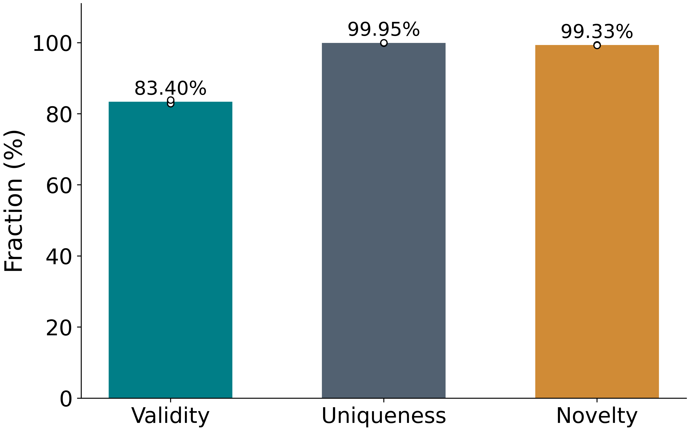
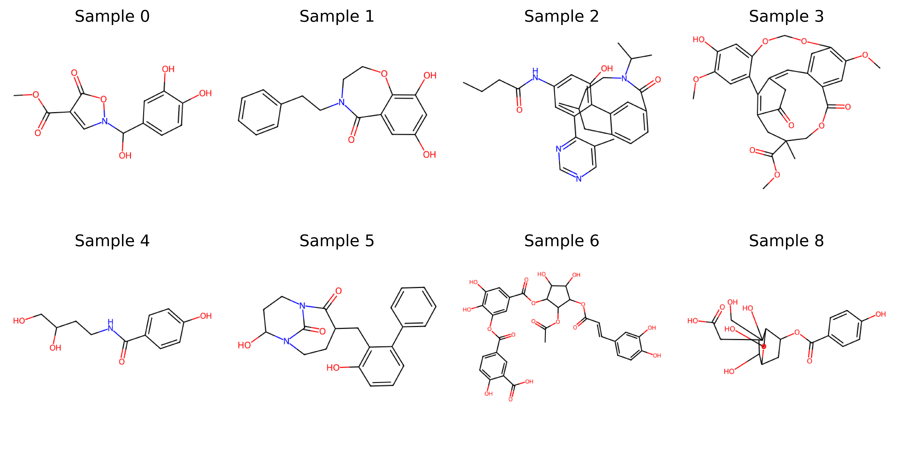
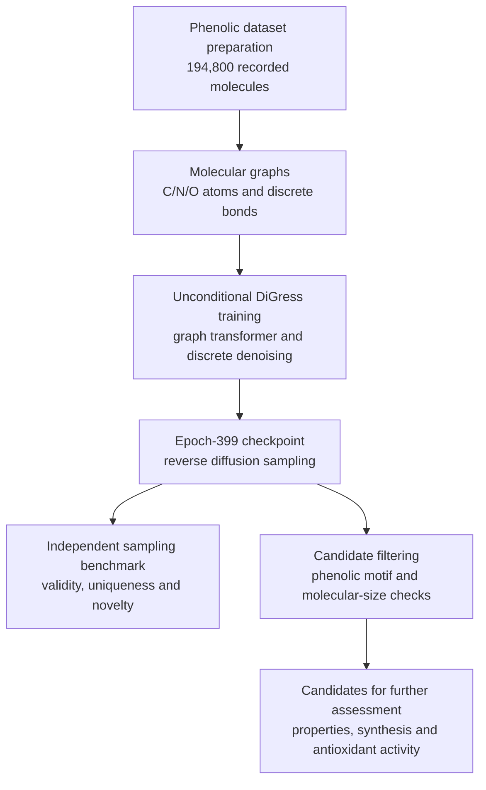

# DiGress for antioxidant-like molecular generation

**Research portfolio · molecular graph diffusion · phenolic candidate generation**

I adapted the DiGress discrete graph diffusion framework to learn a phenolic molecular distribution and generate new structures for antioxidant-oriented screening. The model learns atom and bond patterns; the downstream filters identify candidates for further study. Chemical validity and novelty alone do not demonstrate antioxidant activity, safety or synthetic accessibility.

| Recorded evaluation | Result |
|---|---:|
| Molecules in the graph dataset | 194,800 |
| Train / validation / test | 175,320 / 9,740 / 9,740 |
| Sampling benchmark | 3 × 10,000 draws from one fixed checkpoint |
| Validity | 83.40% ± 0.51 percentage points |
| Uniqueness among valid samples | 99.95% ± 0.06 percentage points |
| Novelty among unique valid samples | 99.33% ± 0.08 percentage points |

Values are means ± sample standard deviations across sampling replicates, **not independent training runs**. Novelty is exact canonical-SMILES absence from the training split, not absence from all chemistry databases. See [evaluation definitions](docs/evaluation.md).


*Bars: replicate means. Individual dots: three recorded sampling replicates. Denominators differ between metrics, as defined above.*


*Eight illustrative valid, connected phenolic samples absent from the training-SMILES set. Selected in sample order, not ranked by activity. Structures are actual recorded generations; identifiers link to [the included table](figures/illustrated_molecules.csv).*

## My research contribution

My work applies an existing graph diffusion architecture to an antioxidant-oriented molecular dataset: preparing graph inputs, adapting the dataset interface, configuring training and sampling, evaluating generated structures, and organizing candidate filtering and reproducible analysis. DiGress is the original authors' architecture; this portfolio highlights the application workflow and its scientific evaluation.

**Skills:** Python, PyTorch, PyTorch Geometric, RDKit, graph transformers, discrete diffusion, dataset preparation, generative-model evaluation, molecular filtering and GPU/HPC workflows.

## Workflow



## Training and generation

The recorded configuration uses 500 diffusion steps, a cosine noise schedule, marginal transitions, a six-layer graph transformer with eight attention heads, and structural/molecular extra features. Training was configured for 500 epochs with batch size 16, AdamW, learning rate 10⁻⁴ and seed 42; the preserved sampling checkpoint is epoch 399. These are the recorded settings, not a claim that this repository has retrained the model.

The discrete training objective combines atom cross-entropy and bond cross-entropy, with bond weight 5 and global-target weight 0. Although the dataset identifier includes `bde`, this run is **unconditional**; it does not directly optimize antioxidant activity or a BDE target. Full settings are in [the recorded configuration](configs/recorded_training.yaml).

## Reproduce the figures

From the repository root, use a compatible Python environment with RDKit, NumPy and Matplotlib:

```bash
pip install -r requirements-analysis.txt
python scripts/reproduce.py
```

This recomputes the three recorded benchmark replicates from sample records and the training-SMILES split, verifies them against the source summary, and exports figures as PNG, PDF and SVG. It requires no GPU or checkpoint. [Training and generation instructions](docs/reproducibility.md) explain the separate requirements and limits for those stages.

## Scientific scope

About 16.6% of benchmark draws failed the recorded strict validity procedure. The benchmark accepts sanitizable disconnected graphs and represents them by their largest fragment; the candidate-generation path applies additional connectedness and phenolic filters. Therefore, benchmark validity is not the fraction that survives the full candidate screen. A random molecular split and high exact-match novelty do not establish new scaffolds or broad generalization. No experimental antioxidant-performance claim is made for the displayed structures.

The broader project includes later screening and simulation stages. This portfolio focuses on training, generation and the independently recorded sampling benchmark; later screening counts and efficacy conclusions are not mixed into these metrics.

## Repository map

- [Data and provenance](data/README.md): split-labelled SMILES, recorded samples and benchmark summaries.
- [Evaluation](docs/evaluation.md): denominators, canonicalization and replicate interpretation.
- [Reproducibility](docs/reproducibility.md): analysis, training and generation dependencies.
- [Source workflow](02_training_and_generation/code): adapted training, dataset, generation and benchmark code.
- [Third-party attribution](THIRD_PARTY_NOTICES.md): DiGress authors and retained license.
- [Local release review](RELEASE_REVIEW.md): publication status and remaining checks.
